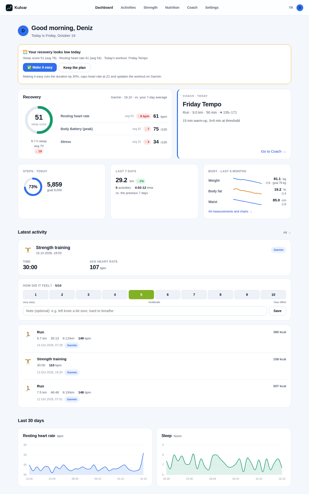
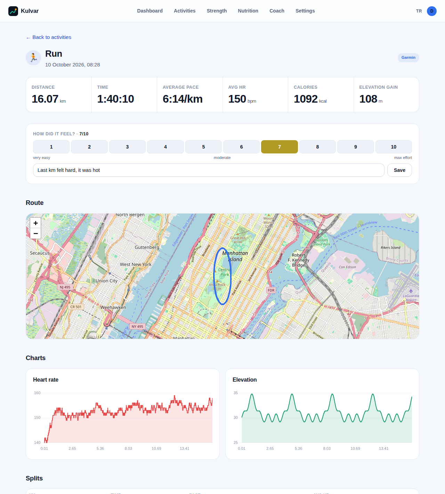
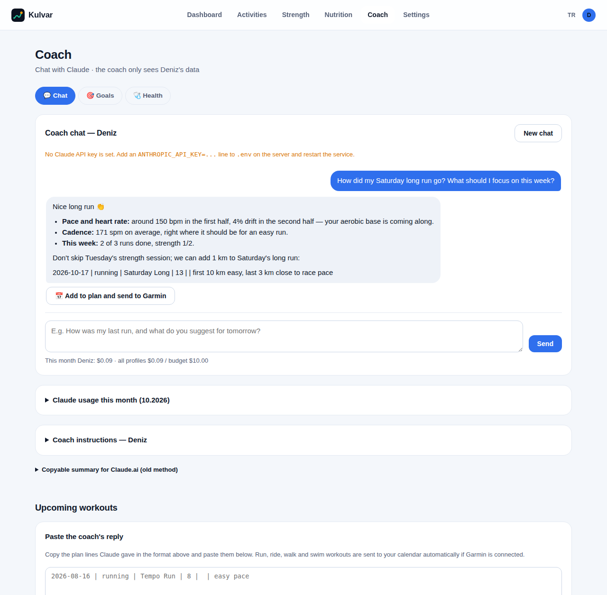
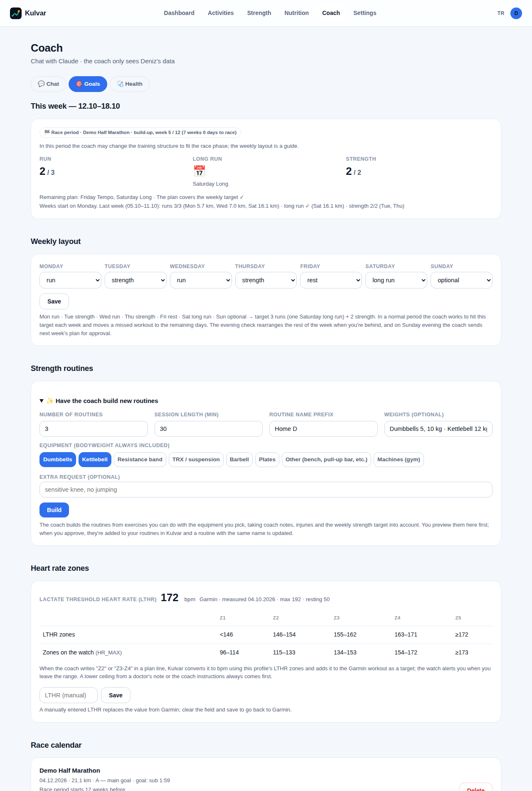
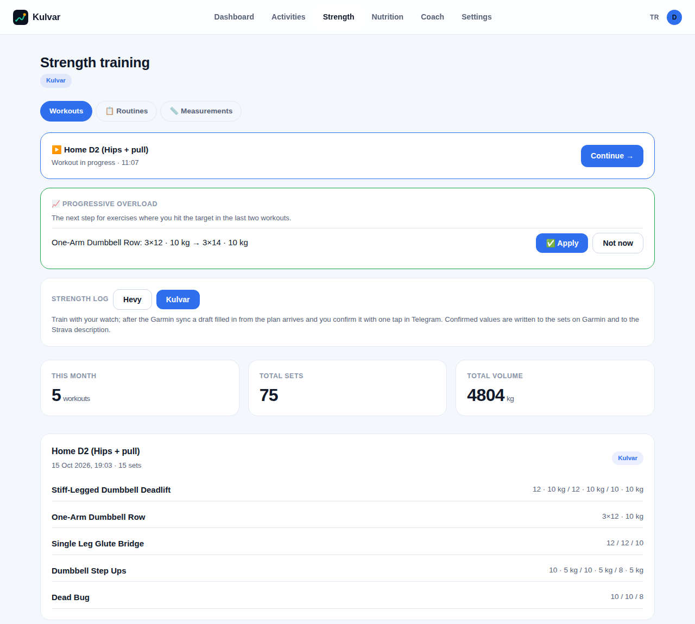
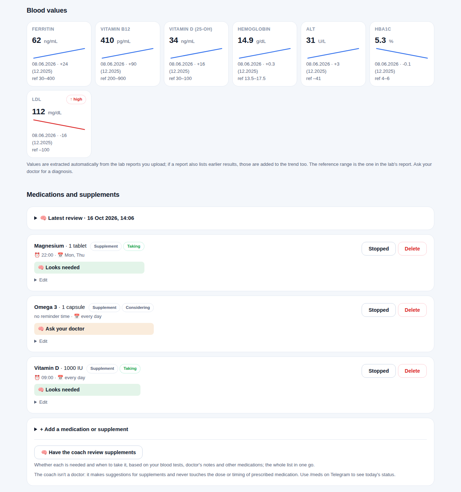
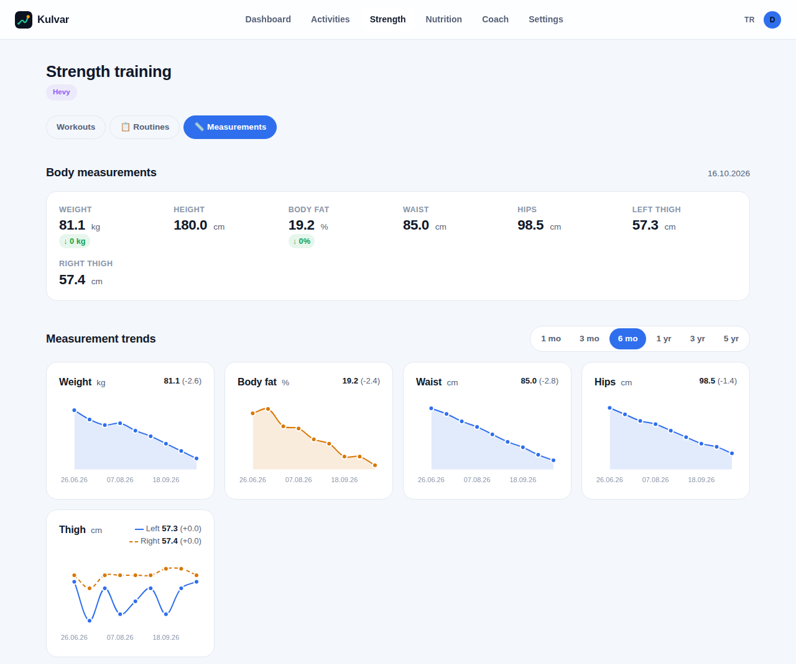
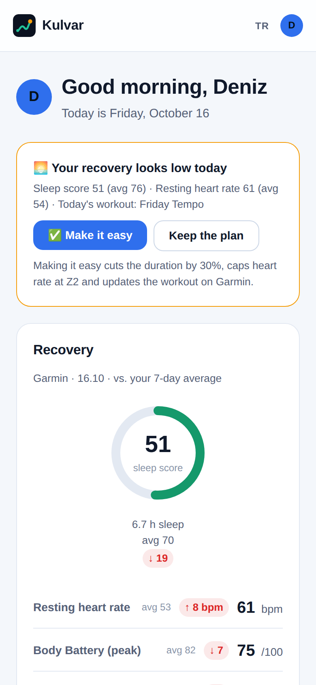
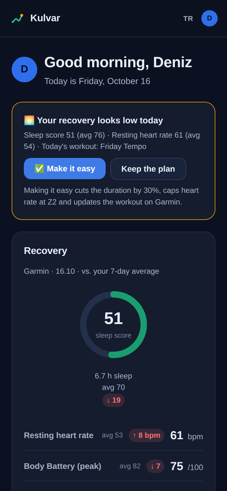
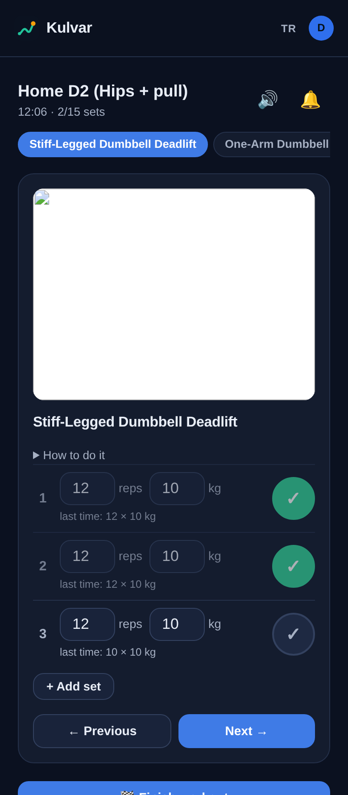

<p align="center"></p>

<h1 align="center">Kulvar</h1>

<p align="center">
A self-hosted training dashboard for runners who also lift: it merges Garmin, Strava, Hevy, and MyFitnessPal data, logs strength workouts on its own (Hevy optional), adds an AI coach (Claude), and lets you manage your plan from Telegram.
<br><br>
<a href="README.tr.md">Türkçe</a> · The UI is available in English and Turkish.<br>
<em>Kulvar</em> is Turkish for <em>lane</em>: everyone in the household trains in their own lane, and the coach keeps you in yours.
</p>

<p align="center"></p>

> All screenshots use the fictional demo data from `scripts/seed_demo.py`. No real person's data is shown.

## Why

Garmin Connect, Strava, Hevy, and MyFitnessPal each keep a slice of your training. Kulvar pulls them into one place for a household: several profiles on one server, each with their own accounts, goals and coach. It runs on a home server behind your own network or VPN, so your data stays with you.

## Features

**Today panel**
- Recovery card: sleep score, resting heart rate, Body Battery, and stress against your 7-day average.
- **Morning readiness:** after a poor night (sleep score, resting heart rate, Body Battery) on a day with a hard run, Kulvar offers to make it easy: 30% shorter, heart rate capped at Z2, and the workout on Garmin is replaced. At most one Telegram message a day.
- **How did it feel?** Rate each workout 1–10 with an optional note. The coach sees the ratings and your weekly session load (RPE × minutes) and gets a warning when it jumps more than 30%.
- Today's planned workout from the coach, plus steps, weekly distance, and body trends.
- Light and dark mode, mobile layout with a bottom nav; installable on the phone's home screen.

**Activities**
- Garmin and Strava duplicates of the same workout are merged.
- Route map, heart rate and elevation charts, km splits, aerobic decoupling.
- Running cadence is shown in steps per minute (Strava's single-leg values are doubled).

**Strength (Hevy optional)**
- **Live workout on your phone:** the exercise animation, reps and weight pre-filled from the plan with last time's values next to them, a ✓ per set, a rest timer that beeps and vibrates, and the screen stays on.
- **Or train with the watch only:** planned strength days go to Garmin as structured workouts with exercise steps and rests. After the sync, Kulvar builds a draft from the watch recording; confirm it with one tap in Telegram or fix the numbers first.
- **Routines:** an editor with a catalog of your exercises plus [free-exercise-db](https://github.com/yuhonas/free-exercise-db) (876 exercises with images). The coach can build routines for the equipment you have.
- **Progressive overload:** when you hit an exercise's target in two sessions within 21 days, Kulvar suggests the next step (more reps, then the next weight you actually own at home). Apply it with one tap.
- **Garmin and Strava stay right:** reps and weights the watch miscounted are corrected on Garmin, and the Strava activity gets the routine name and the exercise list. No duplicate activities.
- Hevy still works: its routines are kept in sync both ways and its full history is imported.
- Body measurements with per-metric charts and a 1-month to 5-year range picker.

**Nutrition**
- MyFitnessPal calories and macros against your goals.

**Coach (Claude API, optional)**
- Per-profile chat. The coach automatically gets a fresh summary of the profile's data with each message.
- **Weekly target:** a weekly layout you choose (default: 3 runs including a Saturday long run, plus 2 strength sessions). Kulvar counts done, planned and missing sessions itself, and the coach fills the gaps in the rest of the week.
- **Race calendar:** an A-priority race switches the coach into race mode with build, taper, race-week and recovery phases.
- Suggested workouts can be added to the plan and pushed to your Garmin calendar with one click; an approved line replaces that day's unfinished plan.
- **Heart-rate targets on the watch:** plans can say `155`, `120-155` or `Z2`; zones come from each profile's lactate threshold (read from Garmin), and the watch alerts outside the range.
- **Coach memory:** the coach keeps its own notes about you up to date and proposes changes to its instructions, which you approve or reject.
- Monthly budget and per-message cost tracking.

**Telegram (optional)**
- One bot and group per profile; two-way chat with the coach.
- ✅ Done · ❌ Skipped · 📅 Move to tomorrow buttons on planned workouts. A skipped workout is removed from Garmin, and the coach can re-plan the week.
- 21:00 evening check, Sunday plan for the next week, `/plan`, `/week`, `/health` and `/doctor` commands.

**Languages**
- English and Turkish, chosen per profile. The interface, the coach's replies and that profile's Telegram bot all follow it; switch with the EN/TR button or under Settings.
- Translations live in `app/locales/en.json`, keyed by the Turkish source text, so adding a language is a matter of adding a catalog.

**Health**
- Reminders for periodic blood tests and cardiology check-ups.
- Upload lab PDFs or photos (several per test) for Claude to summarize.
- **Blood values over time:** ferritin, B12, vitamin D, liver values, HbA1c, lipids, thyroid and more are extracted from each report with their sample dates and shown as trend cards with the lab's reference range.
- **Medications and supplements:** reminders on Telegram (taken / skipped / snooze), specific weekdays, an end date worked out from the pack size, and a coach review of whether each supplement is needed based on your blood tests.
- Doctor notes take priority over the coach's own rules.

**Reliability**
- Nightly backups of the database, health documents and avatars (every backup from the last 14 days plus one a week for 8 weeks), an optional second copy on another disk, and `scripts/restore_backup.py` to restore.
- A Telegram alert when a data source has been failing for 6 hours, and another when it recovers.
- Tests run on every push (GitHub Actions).

<table>
<tr>
<td></td>
<td></td>
</tr>
<tr>
<td></td>
<td></td>
</tr>
<tr>
<td></td>
<td></td>
</tr>
</table>

<p align="center">

&nbsp;&nbsp;

&nbsp;&nbsp;

</p>

## Run with Docker

```bash
git clone https://github.com/L4zyK0ala/kulvar.git && cd kulvar
cp .env.example .env
# put a key in KULVAR_ENCRYPTION_KEY, e.g. the output of:
openssl rand -base64 32 | tr '+/' '-_'
docker compose up -d
```

Open `http://127.0.0.1:8010`. Images are published for **amd64 and arm64** (Raspberry Pi 4/5), and `docker compose` builds one locally if it can't pull it.

- **Try it with demo data** (on an empty database): `docker compose run --rm kulvar python scripts/seed_demo.py --lang en`
- **Update:** `docker compose pull && docker compose up -d`
- **Backups** are taken every night into `/data/backups` (the database volume). To restore: stop the container, then `docker compose run --rm kulvar python scripts/restore_backup.py /data/backups/<file>.tar.gz --yes`. Keep `KULVAR_ENCRYPTION_KEY` somewhere safe too: account credentials can't be decrypted without it.
- **Data** lives in three volumes (database, health documents, avatars), so updates keep it.
- **Time zone:** set `TZ=Europe/Istanbul` (or yours) in `.env`; the dashboard's "today" and the evening check use local time.
- **Port:** published on `127.0.0.1` only. Put nginx in front, and see [Security and privacy](#security-and-privacy) before changing that.

## Try it with demo data (without Docker)

No accounts needed:

```bash
git clone https://github.com/<user>/kulvar.git && cd kulvar
python3 -m venv venv && venv/bin/pip install -r requirements.txt
cp .env.example .env    # then put a key in KULVAR_ENCRYPTION_KEY (command is in the file)
KULVAR_DATABASE_URL=sqlite:///demo.db venv/bin/python scripts/seed_demo.py --lang en
KULVAR_DATABASE_URL=sqlite:///demo.db venv/bin/uvicorn app.main:app --port 8010
```

Then open `http://127.0.0.1:8010` and pick the **Deniz** or **Ece** profile.

## Setup with your own data

1. Install as above, fill in `.env` (every variable is explained in [`.env.example`](.env.example)), and start the app.
2. Create a profile per person.
3. Connect your accounts under **Ayarlar** (Settings):

| Source | What you need | Notes |
|---|---|---|
| Garmin Connect | Your Garmin email and password (MFA supported) | Uses the unofficial `garminconnect` library |
| Strava | `STRAVA_CLIENT_ID` / `STRAVA_CLIENT_SECRET` from [strava.com/settings/api](https://www.strava.com/settings/api) | New Strava apps allow only 1 athlete; a second profile can enter its own Strava app under Settings |
| Hevy | API key (Hevy Pro) | Optional: Kulvar logs strength workouts on its own |
| MyFitnessPal | A session cookie copied from your browser | Unofficial; login with username and password isn't supported. Install separately: `pip install --no-deps myfitnesspal && pip install blessed rich browser_cookie3 cloudscraper measurement lxml` |
| Claude coach | `ANTHROPIC_API_KEY` | Optional. Set `KULVAR_COACH_MONTHLY_BUDGET_USD` as a spending cap |
| Telegram | A bot from @BotFather per profile, added under Settings | Optional. Link a group with `/link CODE` |

The database is SQLite; Postgres or Docker aren't needed. Credentials are stored Fernet-encrypted with `KULVAR_ENCRYPTION_KEY`.

## Security and privacy

- **No login.** Profiles are chosen by clicking, by design. Kulvar assumes it lives on your LAN or behind a VPN (for example WireGuard). **Never expose it directly to the internet.** Bind it to `127.0.0.1` and put nginx in front.
- **What leaves the server:**
  - Your data goes only to the services you connect: Garmin, Strava, Hevy, MyFitnessPal.
  - If you enable the coach, a summary of the profile's training, sleep and health notes goes to the Anthropic API.
  - With Telegram enabled, coach messages pass through Telegram.
- **Uploaded health files** are stored outside the static web folder and aren't served directly.
- `.env`, the database, uploads and certificates are in `.gitignore`.

## HTTPS on your home network

[`deploy/nginx.conf`](deploy/nginx.conf) is a reverse-proxy example for a private name such as `kulvar.internal` (`.internal` is reserved for private networks).

iPhones reject self-signed certificates valid for more than 825 days or missing the `serverAuth` usage. The reliable way is a small private CA, limited to `.internal` names:

```bash
openssl req -x509 -newkey rsa:4096 -nodes -keyout ca.key -out kulvar-ca.crt -days 3650 -subj "/CN=Home CA" \
  -addext "basicConstraints=critical,CA:TRUE,pathlen:0" -addext "keyUsage=critical,keyCertSign,cRLSign" \
  -addext "nameConstraints=critical,permitted;DNS:internal"
openssl req -newkey rsa:2048 -nodes -keyout kulvar.key -out kulvar.csr -subj "/CN=kulvar.internal"
printf "basicConstraints=critical,CA:FALSE\nkeyUsage=critical,digitalSignature,keyEncipherment\nextendedKeyUsage=serverAuth\nsubjectAltName=DNS:kulvar.internal\n" > leaf.cnf
openssl x509 -req -in kulvar.csr -CA kulvar-ca.crt -CAkey ca.key -CAcreateserial -days 730 -sha256 -extfile leaf.cnf -out kulvar.crt
```

Then:
1. Put `kulvar.crt` and `kulvar.key` into nginx.
2. Install `kulvar-ca.crt` on each phone in Safari.
3. On iPhone, turn it on under Settings → General → About → Certificate Trust Settings.
4. Keep `ca.key` private. Because of the name constraint, it can only sign `.internal` names.

## Project layout

```
app/
  main.py, config.py, db.py, models.py     FastAPI app, settings, SQLite models
  integrations/                            Garmin, Strava, Hevy, MyFitnessPal clients
  routers/                                 pages: panel, activities, strength, nutrition, coach, settings
  coach_chat.py, coach_memory.py           Claude chat, cost tracking, coach notes and instruction proposals
  training.py, heart.py, morning.py        weekly target, race phases, heart-rate zones, morning readiness
  telegram_bot.py, daily_check.py          Telegram bots and the evening check
  strength_log.py, live_workout.py         Kulvar's strength log, watch drafts, live workout on the phone
  routines.py, exercise_catalog.py         routine editor, exercise catalog (free-exercise-db)
  progression.py, routine_builder.py       progressive overload, coach-built routines
  workout_library.py, garmin_sets.py       exercise images, Garmin workout steps and set correction
  strava_merge.py                          one Strava activity with the exercise list
  health.py, labs.py, meds.py              check-ups, lab analysis, blood value trends, medications
  feedback.py                              how a workout felt (RPE) and weekly session load
  backup.py, alerts.py                     nightly backups, failing-sync alerts
  i18n.py, locales/en.json                 language selection and the English catalog
  templates/, static/                      Jinja2 templates, CSS, charts
scripts/                                   demo data, restore a backup, translation check, maintenance
tests/                                     pytest suite (fakes for Claude, Garmin, Hevy, Telegram)
deploy/                                    nginx and systemd examples
```

## Limitations

- The Garmin Connect and MyFitnessPal integrations use unofficial libraries and can break when those services change. Check their terms before you use them.
- Kulvar is a personal project, not medical advice. The coach's suggestions don't replace a doctor or a qualified coach.

## License

[MIT](LICENSE)
