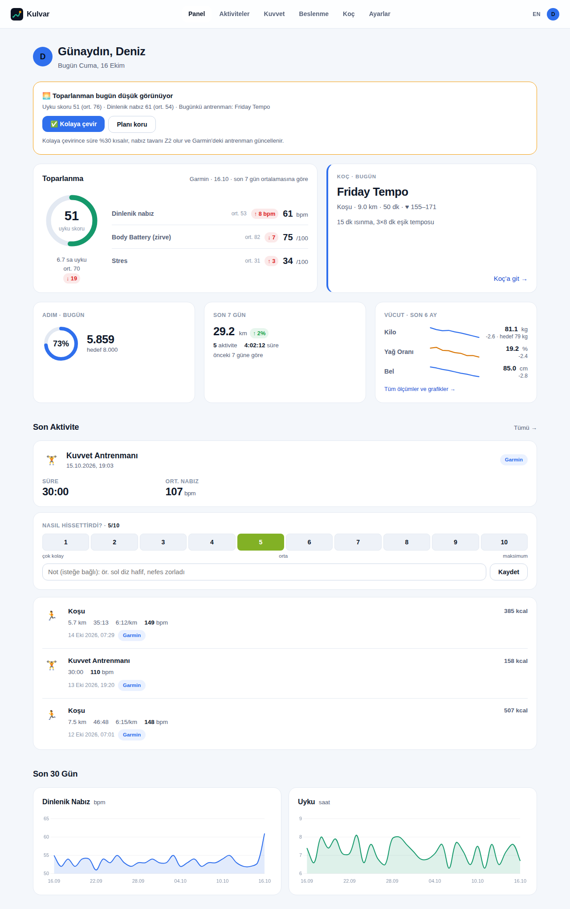
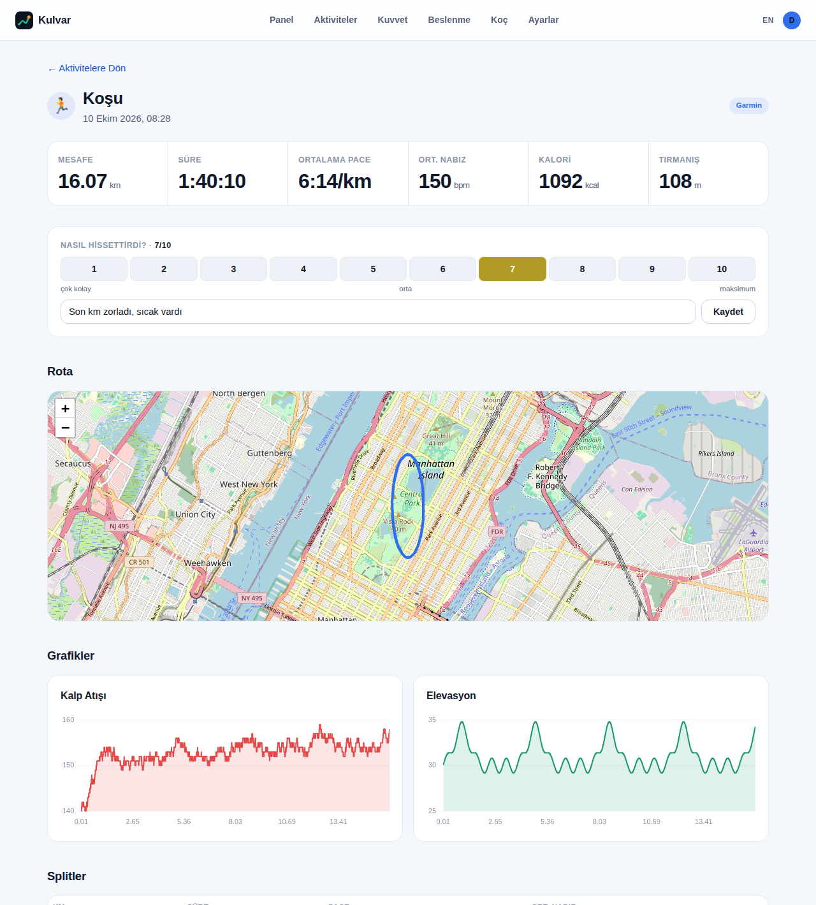
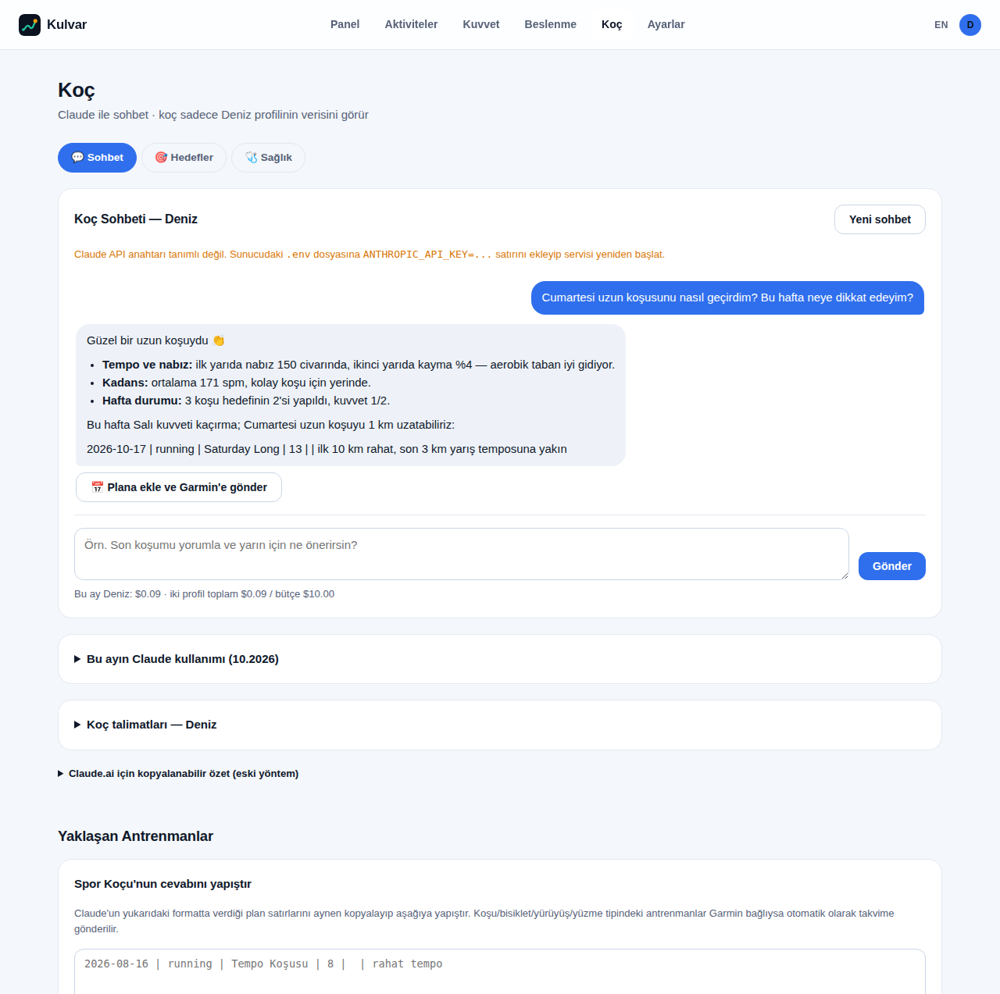
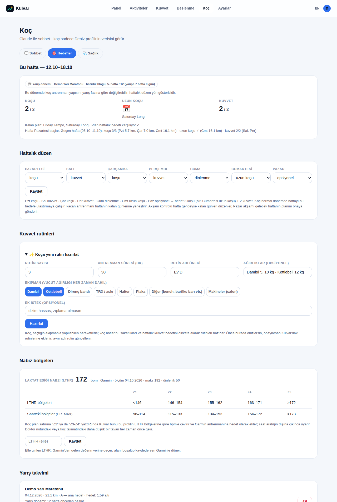
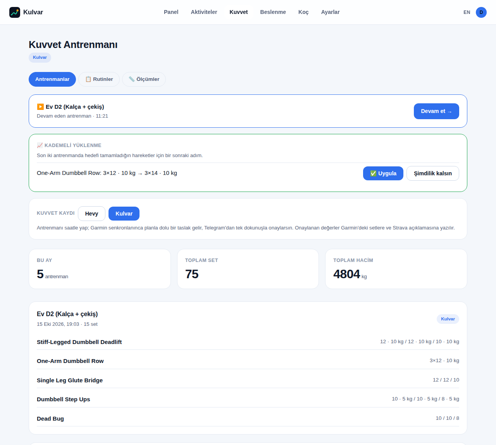
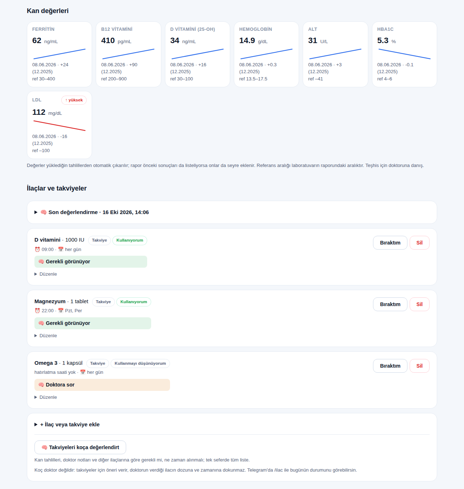
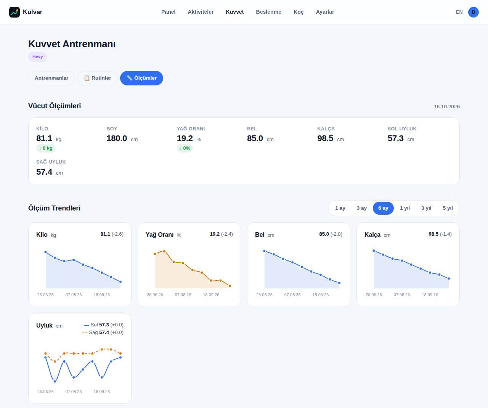
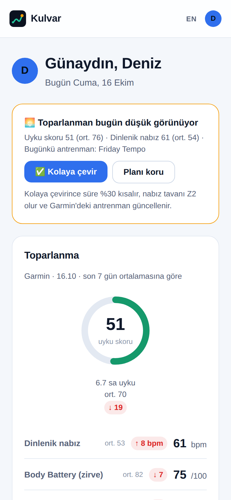
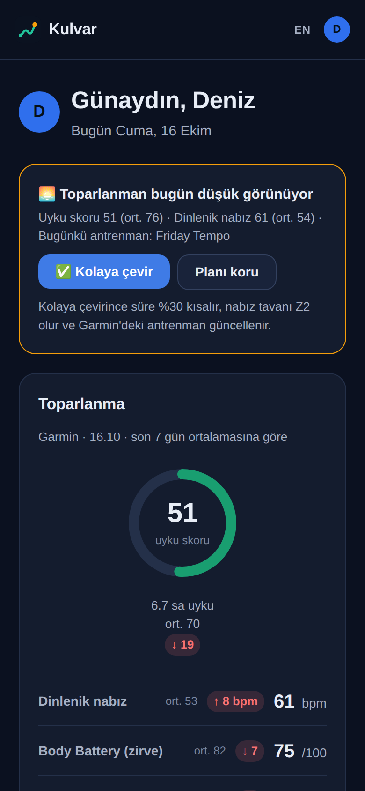
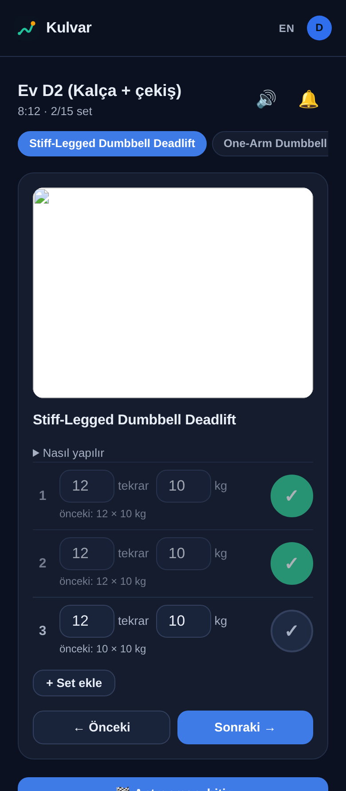

<p align="center"></p>

<h1 align="center">Kulvar</h1>

<p align="center">
Hem koşan hem salona giden sporcular için kendi sunucunda çalışan bir antrenman paneli. Garmin, Strava, Hevy ve MyFitnessPal verilerini birleştirir, kuvvet antrenmanlarını kendisi kaydeder (Hevy isteğe bağlı), Claude ile çalışan bir koç ekler ve planını Telegram'dan yönetmeni sağlar.
<br><br>
<a href="README.md">English</a> · Arayüz Türkçe ve İngilizce.<br>
Hanedeki herkes kendi kulvarında antrenman yapar; koç seni kendi kulvarında tutar.
</p>

<p align="center"></p>

> Ekran görüntülerindeki tüm veriler `scripts/seed_demo.py` ile üretilmiş kurgusal demo verisidir; gerçek bir kişiye ait değildir.

## Neden

Saat, koşu uygulaması, salon kaydı ve beslenme günlüğü antrenmanının ayrı birer parçasını tutar. Kulvar bunları bir hane için tek yerde toplar: bir sunucuda birden fazla profil, her birinin kendi hesapları, hedefleri ve koçu. Ev ağında ya da VPN arkasında çalışır; veriler sende kalır.

## Özellikler

**Bugün paneli**
- Toparlanma kartı: uyku skoru, dinlenik nabız, Body Battery ve stres, 7 günlük ortalamana göre.
- **Sabah hazırlık kontrolü:** Kötü geçen bir gecenin (uyku skoru, dinlenik nabız, Body Battery) ardından o gün zor bir koşu varsa Kulvar onu kolaya çevirmeyi önerir: süre %30 kısalır, nabız tavanı Z2 olur, Garmin'deki antrenman değişir. Telegram'a günde en fazla bir mesaj.
- **Nasıl hissettirdi?** Her antrenmanı 1–10 arası puanla, istersen not ekle. Koç puanları ve haftalık algılanan yükü (puan × dakika) görür; yük %30'dan fazla artınca uyarı alır.
- Koçun bugünkü planı, adım, haftalık mesafe ve vücut trendleri.
- Açık ve koyu tema, alt menülü mobil düzen; telefonun ana ekranına eklenebilir.

**Aktiviteler**
- Aynı antrenmanın Garmin ve Strava kopyaları birleştirilir.
- Rota haritası, nabız ve yükseklik grafikleri, km splitleri, aerobik decoupling.
- Koşu kadansı adım/dk olarak gösterilir (Strava'nın tek bacak değerleri ikiyle çarpılır).

**Kuvvet (Hevy isteğe bağlı)**
- **Telefonda canlı antrenman:** hareketin animasyonu, plandan dolu gelen tekrar ve ağırlık (yanında bir önceki antrenmanın değeri), her set için ✓, süre bitince ses ve titreşimle uyaran dinlenme sayacı; ekran kapanmaz.
- **Ya da sadece saatle:** planlı kuvvet günleri Garmin'e hareket adımları ve dinlenmelerle gider. Senkrondan sonra Kulvar saatin kaydından bir taslak oluşturur; Telegram'dan tek dokunuşla onaylarsın ya da önce değerleri düzeltirsin.
- **Rutinler:** kullandığın hareketler ve [free-exercise-db](https://github.com/yuhonas/free-exercise-db) kataloğuyla (876 görselli hareket) rutin düzenleyici. Koç elindeki ekipmana göre rutin de hazırlar.
- **Kademeli yüklenme:** bir hareketin hedefini 21 gün içindeki iki antrenmanda tutturunca Kulvar bir sonraki adımı önerir (önce tekrar, sonra evde gerçekten olan bir sonraki ağırlık). Tek dokunuşla uygularsın.
- **Garmin ve Strava doğru kalır:** saatin yanlış saydığı tekrar ve ağırlıklar Garmin'de düzeltilir; Strava aktivitesine rutin adı ve hareket listesi yazılır. Çift kayıt oluşmaz.
- Hevy kullanmaya devam edebilirsin: rutinler iki yönlü senkronlanır, tüm geçmiş içe aktarılır.
- Vücut ölçümleri: her ölçüm için grafik ve 1 ay–5 yıl aralık seçici.

**Beslenme**
- MyFitnessPal kalori ve makroları, hedeflerinle birlikte.

**Koç (Claude API, isteğe bağlı)**
- Profil başına sohbet. Koç, her mesajda profilin güncel veri özetini otomatik olarak alır.
- **Haftalık hedef:** seçtiğin haftalık düzen (varsayılan: biri Cumartesi uzun koşu olmak üzere 3 koşu + 2 kuvvet). Yapılan, planlanan ve eksik antrenmanları Kulvar kendisi sayar; koç eksikleri haftanın kalan günlerine yerleştirir.
- **Yarış takvimi:** A öncelikli bir yarış, koçu hazırlık, taper, yarış haftası ve toparlanma fazlarıyla yarış dönemine geçirir.
- Önerilen antrenmanlar tek tıkla plana eklenir ve Garmin takvimine gönderilir; onaylanan satır o günün yapılmamış planının yerine geçer.
- **Saatte nabız hedefi:** planda `155`, `120-155` ya da `Z2` yazılabilir; bölgeler her profilin laktat eşiğinden (Garmin'den okunur) hesaplanır, saat aralık dışına çıkınca uyarır.
- **Koç hafızası:** koç seninle ilgili notlarını kendisi günceller ve talimatlarında değişiklik önerir; sen onaylar ya da reddedersin.
- Aylık bütçe ve mesaj başına maliyet takibi.

**Telegram (isteğe bağlı)**
- Her profile ayrı bot ve grup; koçla iki yönlü sohbet.
- Planlı antrenmanlarda ✅ Yapıldı · ❌ Yapılmadı · 📅 Yarına taşı butonları. Yapılmayan antrenman Garmin'den kaldırılır ve koç haftayı yeniden planlayabilir.
- 21:00 akşam kontrolü, Pazar akşamı gelecek haftanın planı, `/plan`, `/hafta`, `/saglik` ve `/doktor` komutları (İngilizce karşılıkları: `/week`, `/health`, `/doctor`).

**Diller**
- Türkçe ve İngilizce, profil başına seçilir. Arayüz, koçun cevapları ve o profilin Telegram botu bu dili kullanır; üst menüdeki TR/EN düğmesi veya Ayarlar'dan değiştirilir.
- Çeviriler `app/locales/en.json` içinde, Türkçe kaynak metin anahtarıyla durur; yeni bir dil eklemek için bir katalog eklemek yeterli.

**Sağlık**
- Periyodik kan tahlili ve kardiyoloji kontrolü hatırlatmaları.
- Tahlil PDF'i veya fotoğrafı yükle (bir tahlil için birden fazla), Claude özetlesin.
- **Kan değerlerinin seyri:** ferritin, B12, D vitamini, ALT/AST, HbA1c, kolesterol, tiroid ve diğerleri her rapordan numune tarihleriyle çıkarılır; laboratuvarın referans aralığıyla birlikte seyir kartları olarak görünür.
- **İlaçlar ve takviyeler:** Telegram'dan hatırlatma (aldım / atla / ertele), belirli günler, kutudaki adetten hesaplanan bitiş tarihi ve takviyenin tahlillerine göre gerekli olup olmadığına dair koç değerlendirmesi.
- Doktor notları, koçun kendi kurallarının önüne geçer.

**Güvenilirlik**
- Her gece veritabanı, sağlık belgeleri ve profil resimleri yedeklenir (son 14 günün her yedeği ve 8 haftaya kadar haftada bir); isteğe bağlı ikinci diske kopya; geri yüklemek için `scripts/restore_backup.py`.
- Bir veri kaynağı 6 saattir senkronlanamıyorsa Telegram'dan uyarı, düzelince bir mesaj daha.
- Her push'ta testler çalışır (GitHub Actions).

<table>
<tr>
<td></td>
<td></td>
</tr>
<tr>
<td></td>
<td></td>
</tr>
<tr>
<td></td>
<td></td>
</tr>
</table>

<p align="center">

&nbsp;&nbsp;

&nbsp;&nbsp;

</p>

## Docker ile çalıştır

```bash
git clone https://github.com/L4zyK0ala/kulvar.git && cd kulvar
cp .env.example .env
# KULVAR_ENCRYPTION_KEY'e bir anahtar yaz, örneğin şu komutun çıktısı:
openssl rand -base64 32 | tr '+/' '-_'
docker compose up -d
```

`http://127.0.0.1:8010` adresini aç. İmajlar **amd64 ve arm64** (Raspberry Pi 4/5) için yayımlanır; `docker compose` imajı çekemezse yerelde oluşturur.

- **Demo veriyle dene** (boş veritabanında): `docker compose run --rm kulvar python scripts/seed_demo.py`
- **Güncelle:** `docker compose pull && docker compose up -d`
- **Yedekler** her gece `/data/backups` klasörüne (veritabanı biriminde) alınır. Geri yüklemek için konteyneri durdur, sonra: `docker compose run --rm kulvar python scripts/restore_backup.py /data/backups/<dosya>.tar.gz --yes`. `KULVAR_ENCRYPTION_KEY`'i de güvenli bir yerde sakla: hesap bilgileri onsuz çözülemez.
- **Veriler** üç volume'da durur (veritabanı, sağlık belgeleri, profil resimleri); güncellemelerde korunur.
- **Saat dilimi:** `.env` dosyasına `TZ=Europe/Istanbul` (ya da kendi bölgen) yaz; paneldeki "bugün" ve akşam kontrolü yerel saati kullanır.
- **Port:** yalnızca `127.0.0.1` üzerinden açılır. Önüne nginx koy; değiştirmeden önce [Güvenlik ve gizlilik](#güvenlik-ve-gizlilik) bölümünü oku.

## Demo veriyle dene (Docker olmadan)

Hesap bağlamak gerekmez:

```bash
git clone https://github.com/<kullanici>/kulvar.git && cd kulvar
python3 -m venv venv && venv/bin/pip install -r requirements.txt
cp .env.example .env    # KULVAR_ENCRYPTION_KEY'e anahtar yaz (komut dosyada)
KULVAR_DATABASE_URL=sqlite:///demo.db venv/bin/python scripts/seed_demo.py
KULVAR_DATABASE_URL=sqlite:///demo.db venv/bin/uvicorn app.main:app --port 8010
```

Ardından `http://127.0.0.1:8010` adresini aç ve **Deniz** ya da **Ece** profilini seç.

## Kendi verinle kurulum

1. Yukarıdaki gibi kur, `.env` dosyasını doldur (tüm değişkenler [`.env.example`](.env.example) içinde açıklanıyor) ve uygulamayı başlat.
2. Her kişi için bir profil oluştur.
3. Hesaplarını **Ayarlar** sayfasından bağla:

| Kaynak | Gerekenler | Not |
|---|---|---|
| Garmin Connect | Garmin e-posta ve şifren (MFA destekli) | Resmi olmayan `garminconnect` kütüphanesi |
| Strava | [strava.com/settings/api](https://www.strava.com/settings/api) üzerinden `STRAVA_CLIENT_ID` / `STRAVA_CLIENT_SECRET` | Yeni Strava uygulamaları 1 sporcuyla sınırlı; ikinci profil kendi Strava uygulamasını Ayarlar'dan girebilir |
| Hevy | API anahtarı (Hevy Pro) | İsteğe bağlı: Kulvar kuvvet antrenmanlarını kendisi de kaydeder |
| MyFitnessPal | Tarayıcından kopyalanan oturum çerezi | Resmi değil; kullanıcı adı ve şifreyle giriş desteklenmiyor. Ayrı kurulur: `pip install --no-deps myfitnesspal && pip install blessed rich browser_cookie3 cloudscraper measurement lxml` |
| Claude koç | `ANTHROPIC_API_KEY` | İsteğe bağlı. Harcama sınırı için `KULVAR_COACH_MONTHLY_BUDGET_USD` |
| Telegram | Her profil için @BotFather'dan bir bot, Ayarlar'dan eklenir | İsteğe bağlı. Grubu `/bagla KOD` ile bağla |

Veritabanı SQLite'tır; Postgres ya da Docker gerekmez. Kimlik bilgileri `KULVAR_ENCRYPTION_KEY` ile Fernet şifreli saklanır.

## Güvenlik ve gizlilik

- **Giriş ekranı yok.** Profiller tıklanarak seçilir; bu bilinçli bir tercih. Kulvar'ın ev ağında ya da bir VPN (örn. WireGuard) arkasında çalıştığı varsayılır. **Uygulamayı asla doğrudan internete açma.** `127.0.0.1`'e bağla ve önüne nginx koy.
- **Sunucudan dışarı ne çıkar:**
  - Verilerin yalnızca bağladığın servislere gider: Garmin, Strava, Hevy, MyFitnessPal.
  - Koçu açarsan profilin antrenman, uyku ve sağlık notları özeti Anthropic API'ye gider.
  - Telegram açıksa koç mesajları Telegram üzerinden geçer.
- **Yüklenen sağlık dosyaları** statik web klasörünün dışında saklanır ve doğrudan sunulmaz.
- `.env`, veritabanı, yüklenen dosyalar ve sertifikalar `.gitignore` içindedir.

## Ev ağında HTTPS

[`deploy/nginx.conf`](deploy/nginx.conf), `kulvar.internal` gibi özel bir ad için ters vekil (reverse proxy) örneğidir (`.internal` özel ağlar için ayrılmıştır).

iPhone'lar 825 günden uzun geçerli olan veya `serverAuth` kullanımı olmayan self-signed sertifikaları reddeder. Güvenilir yol, yalnızca `.internal` adlarıyla sınırlı küçük bir özel CA'dır. Komutlar [İngilizce README](README.md#https-on-your-home-network) içinde.

Sonra:
1. `kulvar.crt` ve `kulvar.key` dosyalarını nginx'e koy.
2. `kulvar-ca.crt` dosyasını her telefona Safari ile yükle.
3. iPhone'da Ayarlar → Genel → Hakkında → Sertifika Güven Ayarları altından aç.
4. `ca.key` dosyasını gizli tut. Ad kısıtı sayesinde yalnızca `.internal` adları için sertifika imzalayabilir.

## Proje yapısı

```
app/
  main.py, config.py, db.py, models.py     FastAPI uygulaması, ayarlar, SQLite modelleri
  integrations/                            Garmin, Strava, Hevy, MyFitnessPal istemcileri
  routers/                                 sayfalar: panel, aktiviteler, kuvvet, beslenme, koç, ayarlar
  coach_chat.py, coach_memory.py           Claude sohbeti, maliyet takibi, koç notları ve talimat önerileri
  training.py, heart.py, morning.py        haftalık hedef, yarış fazları, nabız bölgeleri, sabah hazırlık
  telegram_bot.py, daily_check.py          Telegram botları ve akşam kontrolü
  strength_log.py, live_workout.py         Kulvar kuvvet kaydı, saatten taslak, telefonda canlı antrenman
  routines.py, exercise_catalog.py         rutin düzenleyici, hareket kataloğu (free-exercise-db)
  progression.py, routine_builder.py       kademeli yüklenme, koçun hazırladığı rutinler
  workout_library.py, garmin_sets.py       hareket görselleri, Garmin adımları ve set düzeltme
  strava_merge.py                          hareket listesiyle tek Strava aktivitesi
  health.py, labs.py, meds.py              kontroller, tahlil yorumu, kan değerleri seyri, ilaçlar
  feedback.py                              antrenmanın nasıl hissettirdiği (RPE) ve haftalık yük
  backup.py, alerts.py                     gecelik yedek, senkron hatası uyarıları
  i18n.py, locales/en.json                 dil seçimi ve İngilizce katalog
  templates/, static/                      Jinja2 şablonları, CSS, grafikler
scripts/                                   demo verisi, yedekten geri yükleme, çeviri kontrolü, bakım betikleri
tests/                                     pytest testleri (Claude, Garmin, Hevy, Telegram yerine sahteler)
deploy/                                    nginx ve systemd örnekleri
```

## Sınırlamalar

- Garmin Connect ve MyFitnessPal entegrasyonları resmi olmayan kütüphaneler kullanır; bu servisler değiştiğinde bozulabilir. Kullanmadan önce kullanım koşullarına bak.
- Kulvar kişisel bir projedir, tıbbi tavsiye değildir. Koçun önerileri bir doktorun ya da yetkin bir antrenörün yerini tutmaz.

## Lisans

[MIT](LICENSE)
